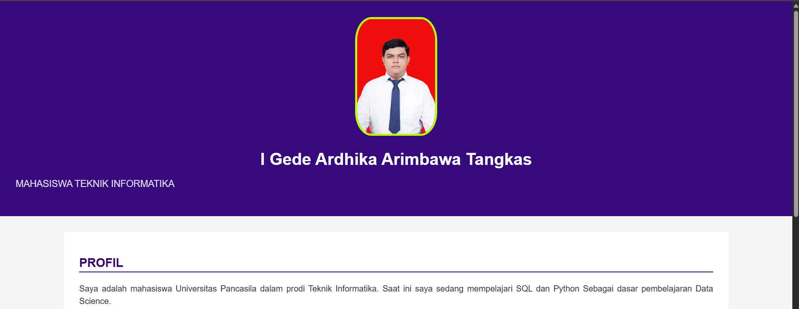
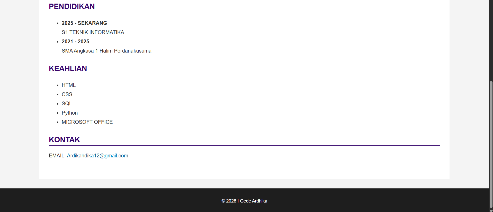
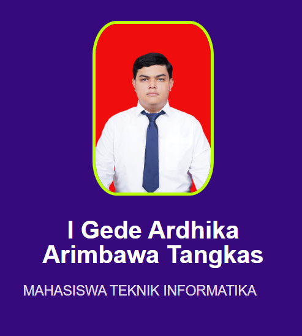
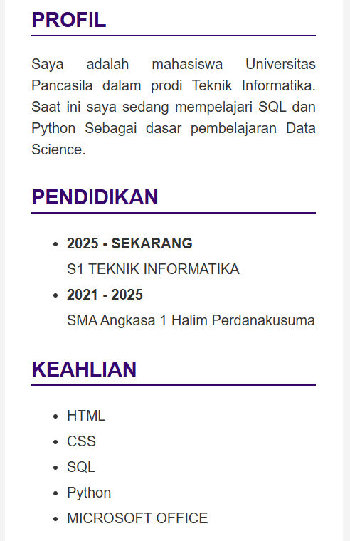
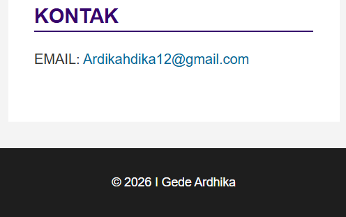
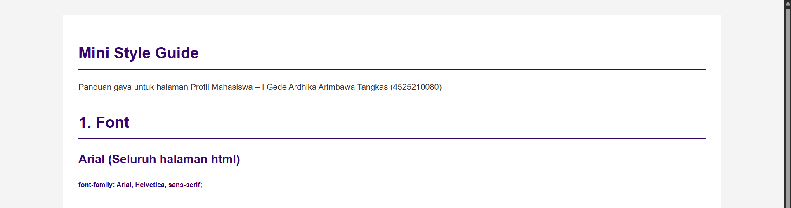
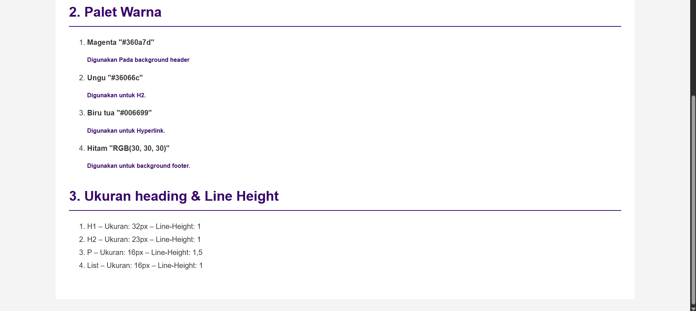
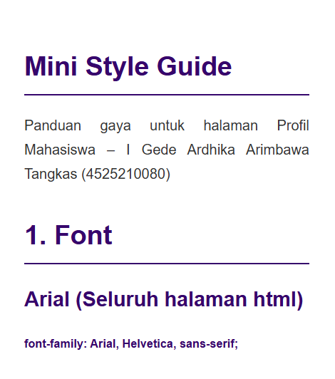
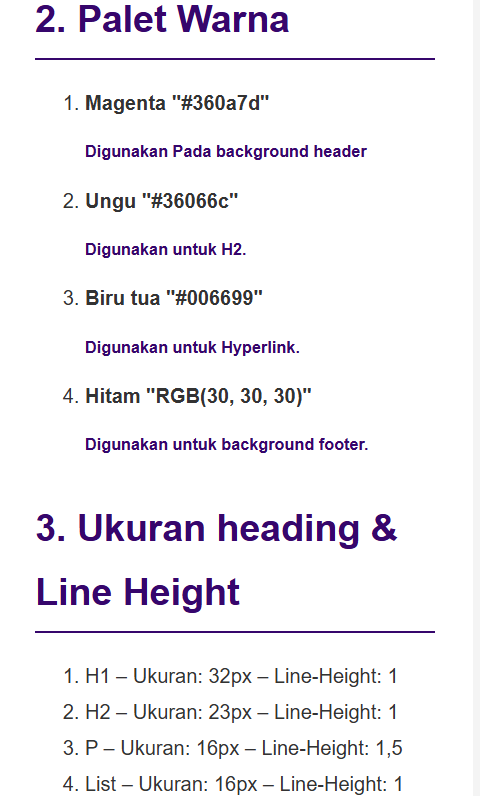

# LAPORAN PRAKTIKUM Desain Web

| Informasi Praktikan | Keterangan |
| :--- | :--- |
| **Nama** | I Gede Ardhika Arimbawa tangkas |
| **NPM** | 4525210080 |
| **Kelas** | A |
| **Mata Kuliah** | Desain Web |
| **Pertemuan** | 3 - CSS Style |

# 1.Kesimpulan Kodingan

Tugas ini berisi halaman profil mahasiswa “LowTierProfile” (index_1.html + Style.css) dan Halaman Mini Style Guide (style-guide.html + guide.css). Halaman profil terdiri dari header (foto, nama, profesi), empat section (Profil, Pendidikan, Keahlian, Kontak), dan footer. Halaman Mini Style Guide berisi dengan 3 poin (Font, Palet warna, dan Ukuran heading & Line Height) yang berada di file Style.css.

## 1.1. Masalah yang Ditemukan

>Link email tidak berfungsi. Pada awalnya link rusak karena kesalahan penulisan. Sebelum dibenarkan, link email dalam href" mailto..." diawali spasi yang mengakibatkan link email tidak dikenali.

>Saran: perbaiki URL dengan menghilangkan spasi dalam href.

# 2. Hasil Run

## 2.1 index.html

### 2.1.1 Desktop

**Hasil Run Header,dan Section profil:**

**Hasil Run Section Pendidikan, Section Keahlian, Section Kontak, dan Footer:**

### 2.1.2 Mobile

**Hasil Run Header:**

**Hasil Run Section profil, pendidikan, dan keahlihan:**

**Hasil Run Section kontak dan footer:**

## 2.2 style-guide.html

### 2.2.1 Desktop

**Hasil Run Section deskripsi dan font:**

**Hasil Run Section palet warna dan Ukuran heading & Line Height:**

### 2.2.2 Mobile

**Hasil Run Section deskripsi dan font:**

**Hasil Run Section palet warna dan Ukuran heading & Line Height:**

